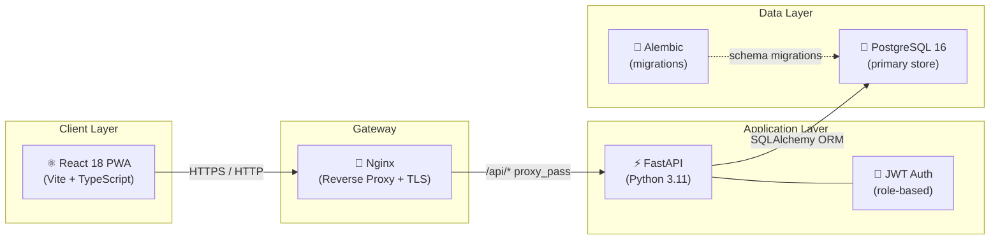

# 🏭 Order-to-Audit System


> **Internship Assignment** — Centre for Digital Infrastructure, NIT Tiruchirappalli

---

## 📋 Overview

The **Order-to-Audit System** is a full-stack, production-quality business management platform developed for **Kaveri Crunch Foods Pvt. Ltd.**, a snack manufacturing company based in Tamil Nadu. The system digitises and integrates every step of the operational cycle — from raw-material procurement and production planning through sales order management, invoicing, payment collection, and financial auditing — into a single, role-gated web application.

Designed with small-to-medium Indian food manufacturers in mind, the platform supports GST-compliant invoicing (CGST + SGST split), weighted-average costing of raw materials, and a fully offline-capable Progressive Web App (PWA) frontend so field salespeople can capture orders even without connectivity.

---

## 🏗️ Architecture



**Request flow (plain text):**

```
React PWA  →  Nginx (port 80/443)  →  FastAPI (port 8000)  →  PostgreSQL (port 5432)
```

Static assets are served by Nginx directly; API calls are proxied to FastAPI. JWT tokens are stored in `localStorage` on the client and validated on every protected endpoint.

---

## ✨ Feature Highlights

| # | Module | Description |
|---|--------|-------------|
| 1 | **User & Role Management** | Six roles (Owner, Factory Admin, Salesman, Production Supervisor, Accountant/Auditor, System) with fine-grained permission guards |
| 2 | **Customer Master** | GSTIN validation, credit-limit tracking, zone assignment |
| 3 | **Product Catalogue** | SKU management with HSN codes, unit of measure, and GST rate configuration |
| 4 | **Raw Material & Packaging Procurement** | GRN creation, weighted-average rate recalculation on each receipt |
| 5 | **Inventory / Stock Ledger** | Real-time stock levels for raw materials, packaging, and finished goods |
| 6 | **Production Batch Management** | Multi-input BOM capture, good-output vs. reject tracking, per-packet COGS calculation |
| 7 | **Sales Order Management** | Draft → Confirmed → Fulfilled lifecycle with stock reservation |
| 8 | **GST-Compliant Invoicing** | Auto CGST + SGST split, invoice PDF generation, B2B / B2C handling |
| 9 | **Payment Collection** | Partial and full payment recording, outstanding-balance computation |
| 10 | **Accounts Receivable Ageing** | 0–30 / 31–60 / 61–90 / 90+ day buckets per customer |
| 11 | **Cost Audit Trail** | Immutable production cost records for auditor review |
| 12 | **Dashboard & KPIs** | Revenue, gross margin, top customers, low-stock alerts — role-filtered |
| 13 | **PWA / Offline Mode** | Service-worker caching for order capture without connectivity |
| 14 | **Seed & Demo Data** | One-command seeder recreates the full benchmark scenario |

---

## 🛠️ Tech Stack

### Backend
| Component | Technology |
|-----------|-----------|
| Language | Python 3.11 |
| Web framework | FastAPI 0.111 |
| ORM | SQLAlchemy 2 (async) |
| Database | PostgreSQL 16 |
| Migrations | Alembic |
| Auth | python-jose (JWT) + passlib (bcrypt) |
| Validation | Pydantic v2 |
| Testing | pytest + httpx (AsyncClient) |
| PDF generation | ReportLab |

### Frontend
| Component | Technology |
|-----------|-----------|
| UI library | React 18 |
| Language | TypeScript 5 |
| Build tool | Vite 5 |
| Routing | React Router v6 |
| State / data | TanStack Query v5 |
| UI components | shadcn/ui + Tailwind CSS |
| Forms | React Hook Form + Zod |
| PWA | vite-plugin-pwa (Workbox) |
| Charts | Recharts |

### Infrastructure
| Component | Technology |
|-----------|-----------|
| Container runtime | Docker + Docker Compose v2 |
| Reverse proxy | Nginx 1.25 (Alpine) |
| CI-ready | GitHub Actions compatible |
| Environment config | `.env` files (see `.env.example`) |

---

## 🚀 Quick Start (Docker Compose)

> **Prerequisites:** Docker Desktop ≥ 4.25 and Docker Compose v2 installed and running.

```bash
# 1. Clone the repository
git clone https://github.com/<org>/order-to-audit-system.git
cd order-to-audit-system

# 2. Copy environment template
cp .env.example .env          # review and adjust if needed

# 3. Build and start all services (backend, frontend, database, nginx)
docker compose up --build

# 4. Seed demo data (run once, in a separate terminal)
docker compose exec backend python -m scripts.seed

# 5. Open the application
#    Frontend  →  http://localhost:5173
#    API Docs  →  http://localhost:8000/docs
```

To stop all services:

```bash
docker compose down           # keeps volumes (database data intact)
docker compose down -v        # also removes volumes (full reset)
```

---

## 🔧 Manual Setup

### Backend

```bash
cd backend

# Create and activate virtual environment
python -m venv .venv
# Windows
.venv\Scripts\activate
# macOS / Linux
source .venv/bin/activate

# Install dependencies
pip install -r requirements.txt

# Configure environment
cp .env.example .env
# Edit .env — set DATABASE_URL, SECRET_KEY, etc.

# Run database migrations
alembic upgrade head

# Seed demo data
python -m scripts.seed

# Start the development server
uvicorn app.main:app --reload --host 0.0.0.0 --port 8000
```

### Frontend

```bash
cd frontend

# Install dependencies
npm install

# Start the Vite development server
npm run dev
# → http://localhost:5173
```

> The Vite dev server proxies `/api/*` requests to `http://localhost:8000` automatically (configured in `vite.config.ts`).

---

## 🔑 Demo Credentials

All demo accounts share the password **`demo123`**.

| Username | Password | Role | Zone / Scope |
|----------|----------|------|--------------|
| `admin_user` | `demo123` | Factory Admin | All zones — full operational access |
| `salesman_1` | `demo123` | Salesman | Trichy Zone |
| `salesman_2` | `demo123` | Salesman | Madurai Zone |
| `prod_supervisor` | `demo123` | Production Supervisor | Production floor |
| `accountant_1` | `demo123` | Accountant / Auditor | Read-only audit + reports |
| `owner_user` | `demo123` | Owner | All — including financials dashboard |

> **Security notice:** These credentials are for demonstration purposes only. Change all passwords and rotate the `SECRET_KEY` before any production deployment.

---

## 📖 API Documentation

Interactive Swagger UI (auto-generated by FastAPI):

```
http://localhost:8000/docs
```

ReDoc alternative:

```
http://localhost:8000/redoc
```

The OpenAPI schema is exported to `docs/openapi.json` during the Docker build for offline reference.

---

## 🧪 Running Tests

```bash
cd backend

# Activate virtual environment (if not already active)
.venv\Scripts\activate        # Windows
# source .venv/bin/activate   # macOS / Linux

# Run the full test suite
.venv\Scripts\pytest.exe -v
```

Expected output — **9 tests, all passing:**

```
collected 9 items

tests/test_auth.py::test_login_valid_user          PASSED
tests/test_auth.py::test_login_invalid_password    PASSED
tests/test_procurement.py::test_weighted_avg_rate  PASSED
tests/test_procurement.py::test_grn_stock_update   PASSED
tests/test_production.py::test_batch_cogs          PASSED
tests/test_production.py::test_reject_tracking     PASSED
tests/test_invoicing.py::test_gst_split            PASSED
tests/test_invoicing.py::test_outstanding_balance  PASSED
tests/test_invoicing.py::test_payment_partial      PASSED

============================== 9 passed in 3.42s ==============================
```

---

## 🔐 Role Capabilities

| Permission | Owner | Factory Admin | Salesman | Production Supervisor | Accountant / Auditor |
|------------|:-----:|:-------------:|:--------:|:---------------------:|:--------------------:|
| View all dashboards & KPIs | ✅ | ✅ | ❌ | ❌ | ✅ |
| Manage users & roles | ✅ | ✅ | ❌ | ❌ | ❌ |
| Create / approve purchase GRNs | ✅ | ✅ | ❌ | ✅ | ❌ |
| Create production batches | ✅ | ✅ | ❌ | ✅ | ❌ |
| Create sales orders & invoices | ✅ | ✅ | ✅ | ❌ | ❌ |
| Record payments | ✅ | ✅ | ✅ | ❌ | ❌ |
| View cost audit trail | ✅ | ❌ | ❌ | ❌ | ✅ |
| View AR ageing reports | ✅ | ✅ | ❌ | ❌ | ✅ |
| Export PDF / Excel reports | ✅ | ✅ | ❌ | ❌ | ✅ |
| System configuration | ✅ | ❌ | ❌ | ❌ | ❌ |

---

## 📊 Section 15 Benchmark Walkthrough

The seeder (`scripts/seed.py`) creates a canonical scenario whose computed numbers can be verified end-to-end through the UI or API. The figures below **must match exactly** after a fresh seed.

### Step 1 — Raw Material Procurement (Wheat Flour)

| GRN | Qty (kg) | Rate (₹/kg) | Stock after GRN |
|-----|----------|-------------|-----------------|
| GRN-001 | 100 kg | ₹42.00 | 100 kg |
| GRN-002 | 60 kg | ₹45.00 | 160 kg |

**Weighted-average rate after GRN-002:**

$$\text{Avg Rate} = \frac{(100 \times 42) + (60 \times 45)}{100 + 60} = \frac{4{,}200 + 2{,}700}{160} = \frac{6{,}900}{160} = \textbf{₹43.125 / kg}$$

> Verify at **Inventory → Raw Materials → Wheat Flour → Rate History**.

---

### Step 2 — Production Batch (Masala Peanuts — Batch B-001)

| Cost Component | Input | Amount |
|----------------|-------|--------|
| Raw material (Wheat Flour 80 kg × ₹43.125) | 80 kg | ₹3,435.00 |
| Packaging material | — | ₹620.00 |
| Labour | — | ₹1,200.00 |
| Gas / fuel | — | ₹600.00 |
| **Total batch cost** | | **₹5,855.00** |
| Good output | 188 packets | — |
| Rejected / waste | 4 packets | — |
| **Cost per good packet** | | **₹5,855 ÷ 188 = ₹31.14 / packet** |

> Verify at **Production → Batch B-001 → Cost Summary**.  
> The COGS figure ₹31.14 (rounded to 2 dp) will appear on the Audit Trail visible to `accountant_1`.

---

### Step 3 — Sales Invoice (INV-001, Customer: Retail Mart Trichy)

| Line Item | Qty | Unit Price | Amount |
|-----------|-----|-----------|--------|
| Masala Peanuts (200 g pack) | 150 pkts | ₹50.00 | ₹7,500.00 |
| CGST @ 2.5% | | | ₹187.50 |
| SGST @ 2.5% | | | ₹187.50 |
| **Invoice Total** | | | **₹7,875.00** |

> GST rate for snacks (HSN 1905) is 5% split equally as 2.5% CGST + 2.5% SGST for intra-state supply.

---

### Step 4 — Payment & Outstanding Balance

| Event | Amount | Running Outstanding |
|-------|--------|-------------------|
| Invoice raised | ₹7,875.00 | ₹7,875.00 |
| Payment received (cheque) | ₹4,000.00 | **₹3,875.00** |

> Verify at **Accounts Receivable → Retail Mart Trichy → Ledger**.  
> The AR Ageing report will bucket ₹3,875.00 in the 0–30 day column immediately after seeding.

---

## 📱 PWA / Offline Support

The frontend is a **Progressive Web App** built with Vite and `vite-plugin-pwa` (Workbox):

- **Install prompt:** Users on Chrome/Edge/Safari are offered an "Add to Home Screen" prompt.
- **Offline order capture:** The service worker caches the app shell and static assets. Salespeople can open existing orders, create new draft orders, and record notes while offline. All mutations are queued in IndexedDB and synced automatically when connectivity is restored.
- **Background sync:** Uses the Background Sync API (where supported) to replay failed POST/PATCH requests.
- **Cache strategy:**
  - App shell & assets → `CacheFirst`
  - API responses (read-only lists) → `StaleWhileRevalidate` with 5-minute TTL
  - Mutation endpoints → Network-only with offline queue fallback

> Offline mode is designed for field salespeople (`salesman_1`, `salesman_2`) operating in areas with intermittent connectivity.

---

## 🧾 GST Disclaimer

This software generates **illustrative** GST invoices for demonstration and educational purposes only. The GST rates, HSN codes, and computation logic are based on publicly available CBIC schedules as of 2024 and may not reflect the latest notifications or amendments. **This system is not a certified GST-compliant software** under the GST Act, 2017. Consult a qualified tax professional and use GSTN-approved software for actual tax filings.

---

## 📂 Project Structure

```
order-to-audit-system/
├── backend/
│   ├── app/
│   │   ├── api/          # Route handlers (routers)
│   │   ├── core/         # Config, security, dependencies
│   │   ├── models/       # SQLAlchemy ORM models
│   │   ├── schemas/      # Pydantic request/response schemas
│   │   └── services/     # Business logic layer
│   ├── alembic/          # Database migrations
│   ├── scripts/
│   │   └── seed.py       # Demo data seeder
│   ├── tests/            # pytest test suite (9 tests)
│   ├── requirements.txt
│   └── Dockerfile
├── frontend/
│   ├── src/
│   │   ├── components/   # Reusable UI components
│   │   ├── pages/        # Route-level page components
│   │   ├── hooks/        # Custom React hooks
│   │   ├── api/          # TanStack Query API clients
│   │   └── lib/          # Utilities, formatters, Zod schemas
│   ├── public/
│   ├── vite.config.ts
│   ├── package.json
│   └── Dockerfile
├── nginx/
│   └── nginx.conf
├── docker-compose.yml
├── .env.example
└── README.md
```

---

## 🤝 Acknowledgements

Developed as part of the **Summer Internship Programme** at the  
**Centre for Digital Infrastructure, National Institute of Technology Tiruchirappalli (NIT Trichy)**.

Client context: **Kaveri Crunch Foods Pvt. Ltd.**, Tamil Nadu — a small-scale snack manufacturer producing ready-to-eat peanut and lentil snacks for retail distribution across the Trichy and Madurai zones.

---

## 📄 License

This project is licensed under the **MIT License**.

```
MIT License

Copyright (c) 2024 Centre for Digital Infrastructure, NIT Tiruchirappalli

Permission is hereby granted, free of charge, to any person obtaining a copy
of this software and associated documentation files (the "Software"), to deal
in the Software without restriction, including without limitation the rights
to use, copy, modify, merge, publish, distribute, sublicense, and/or sell
copies of the Software, and to permit persons to whom the Software is
furnished to do so, subject to the following conditions:

The above copyright notice and this permission notice shall be included in all
copies or substantial portions of the Software.

THE SOFTWARE IS PROVIDED "AS IS", WITHOUT WARRANTY OF ANY KIND, EXPRESS OR
IMPLIED, INCLUDING BUT NOT LIMITED TO THE WARRANTIES OF MERCHANTABILITY,
FITNESS FOR A PARTICULAR PURPOSE AND NONINFRINGEMENT. IN NO EVENT SHALL THE
AUTHORS OR COPYRIGHT HOLDERS BE LIABLE FOR ANY CLAIM, DAMAGES OR OTHER
LIABILITY, WHETHER IN AN ACTION OF CONTRACT, TORT OR OTHERWISE, ARISING FROM,
OUT OF OR IN CONNECTION WITH THE SOFTWARE OR THE USE OR OTHER DEALINGS IN THE
SOFTWARE.
```
